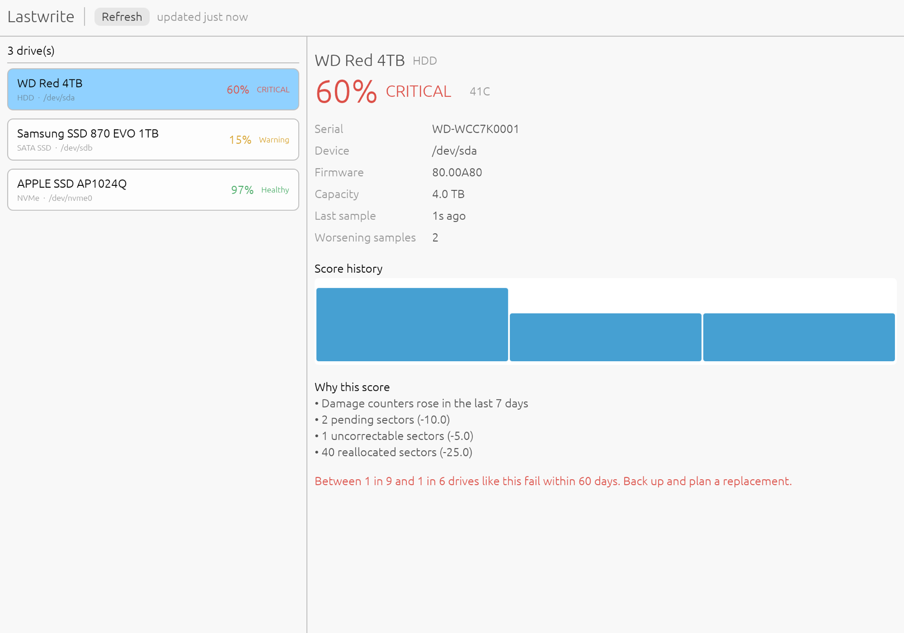

<p align="center">
  
</p>

<h1 align="center">Lastwrite</h1>

<p align="center">
  <strong>Know which disk to replace next, before it takes your data.</strong>
</p>

<p align="center">
  <a href="https://github.com/afaf-tech/lastwrite/actions/workflows/ci.yml"></a>
  <a href="https://github.com/afaf-tech/lastwrite/actions/workflows/release.yml"></a>
  <a href="#known-limits"></a>
</p>

Lastwrite watches the health of your hard drives and SSDs and tells you which one
to replace next. It reads S.M.A.R.T. data through `smartctl`, turns it into a
health score and a risk tier, keeps the history in a local SQLite file, and can
alert you through a webhook or Telegram. On Linux it also finds SATA disks behind
an HBA and USB enclosures that `smartctl --scan` does not list.

It is a small Rust toolchain: a CLI binary with an interactive terminal dashboard
and a background daemon, plus an optional desktop app. There is no web server, no
Docker and no database to install.



*Desktop dashboard with sample drives. The HDD is Critical because its damage
counters rose in the last 7 days, not just because of the score.*

> **Status: early.** Detection and scoring have been run on a real Proxmox VE
> host with a SATA SSD, a USB SSD and an NVMe drive. HDD scoring is still covered
> only by recorded and simulated data. See [Known limits](#known-limits) before
> relying on it.

## Why Lastwrite

- **Predictive, not just a snapshot.** It checks whether the damage counters
  moved in the last 7 days. A rising counter is a stronger signal than a low
  score, and it decides the Critical tier.
- **Explainable.** Every score lists the attributes that cost points, so you can
  see why a drive is at risk instead of trusting a black box.
- **One tool for every machine.** TUI over SSH, plain text for scripts, a daemon
  for alerts, and an optional desktop window. All modes share one SQLite file.
- **Small.** One Rust binary, embedded SQLite, no runtime, no Docker and no web
  server. The desktop window is an opt-in feature.

## Requirements

- [smartmontools](https://www.smartmontools.org/) (`smartctl`) on your `PATH`
- Rust (stable) to build from source
- Root or Administrator rights on most systems, because `smartctl` needs them to
  read drives

## Install

```sh
# Debian/Ubuntu; on macOS: brew install smartmontools
sudo apt install smartmontools

# CLI: terminal dashboard, report and daemon
cargo build --release

# also build the desktop app (target/release/lastwrite-desktop)
cargo build --release --features gui
```

The desktop window is an optional feature so a headless server build does not
pull in any GUI libraries.

The `Makefile` wraps the common work; `make` on its own lists the targets:

```sh
make test          # tests with and without the desktop feature
make lint          # clippy, zero warnings
make app           # Lastwrite.app (macOS, ad-hoc signed)
make dmg           # Lastwrite-<version>.dmg plus SHA256SUMS
make install-app   # build, replace /Applications/Lastwrite.app and launch it
```

## Use

```sh
lastwrite                  # dashboard in a terminal, plain text when piped
lastwrite gui              # desktop window from the CLI binary
lastwrite-desktop          # the same window, for launchers and app bundles
lastwrite report           # always plain text
lastwrite daemon           # poll in the background and send alerts
lastwrite alert-test       # send a test message to your alert channels
```

Add `--db PATH` to any of these to use a different history file. By default it is
`lastwrite/lastwrite.sqlite` in your user config directory.

In the dashboard, press `r` to refresh, the arrow keys to select a drive and `q`
to quit.

Example output (sample drives):

```text
WD Red 4TB (HDD): 60%, CRITICAL, 41C
  - Damage counters rose in the last 7 days
  - 2 pending sectors (-10.0)
  - 1 uncorrectable sectors (-5.0)
  - 40 reallocated sectors (-25.0)
  Between 1 in 9 and 1 in 6 drives like this fail within 60 days. Back up and plan a replacement.
Samsung SSD 870 EVO 1TB (SATA SSD): 15%, Warning, 34C
  - 85% of rated endurance used
APPLE SSD AP1024Q (NVMe): 97%, Healthy, 41C
  - 3% of rated endurance used
```

## Desktop app

`lastwrite gui` opens a native window with the same drive list as the terminal
dashboard: select a drive on the left to see its score, tier, temperature, score
history and the reasons behind the score. Press **Refresh** to poll again. It
reads and writes the same SQLite file as the other modes, so the history is
shared, and it does not need a terminal.

The window is built with egui and only compiles when the `gui` feature is
enabled, which keeps builds for servers free of GUI dependencies.

`lastwrite-desktop` is a separate binary that always opens the window, so a
launcher or a double-click never needs an argument; it accepts the same
`--db PATH` option. To package it:

- **macOS:** `make app` builds `target/macos/Lastwrite.app`, and `make dmg`
  produces `target/dist/Lastwrite-<version>.dmg` with a `SHA256SUMS` file.
  `contrib/macos-app.sh` is the underlying script and needs only Xcode
  command-line tools.
- **Any platform:** with [cargo-bundle](https://github.com/burtonageo/cargo-bundle)
  installed, `cargo bundle --release --features gui --bin lastwrite-desktop`
  produces a native package from the `[package.metadata.bundle]` settings.

## Alerts

The daemon polls every 4 hours and alerts when a drive gets worse, not on every
poll. It alerts when:

- a drive enters the Warning or Critical tier, or moves from Warning to Critical
- a drive goes above the temperature limit (it re-arms after cooling 5°C below it)
- a drive stops responding for two polls in a row (drives that are asleep are skipped)

Alert state is stored in the database, so a restart does not repeat alerts. If a
send fails, the daemon polls again after 5 minutes instead of waiting for the
full interval. An alert counts as delivered when at least one channel accepts it.

Settings come from environment variables. See
[contrib/lastwrite.env.example](contrib/lastwrite.env.example):

| Variable | Meaning | Default |
|---|---|---|
| `LASTWRITE_WEBHOOK_URL` | Slack, Discord or any endpoint that accepts a JSON POST | none |
| `LASTWRITE_TELEGRAM_TOKEN`, `LASTWRITE_TELEGRAM_CHAT_ID` | Telegram bot (both required) | none |
| `LASTWRITE_INTERVAL_SECONDS` | Time between polls | 14400 |
| `LASTWRITE_TEMP_LIMIT` | Temperature alert limit in °C | 55 |

On Linux, [contrib/lastwrite.service](contrib/lastwrite.service) is a systemd
unit. There is no Windows service wrapper yet.

## How drives are scored

**HDDs** start at 100 and lose points for reallocated sectors, pending sectors,
uncorrectable sectors and spin retries. **NVMe drives** score 100 minus the
percentage of rated endurance used, and a spare-capacity or controller critical
warning caps the score at 9. **SATA SSDs** score the same way from the normalized
value of their vendor wear attribute, and a drive with no recognised attribute
shows `Unknown`.

For HDDs the score alone is a weak signal, so Lastwrite also checks whether the
damage counters rose in the last 7 days. That check, not the score, decides the
highest tier. Every score shows the attributes that cost points.

| Tier | Condition | Chance of failing within 60 days |
|---|---|---|
| Healthy | Score 100 | about 0.1% |
| Watch | Score below 100 and stable | about 1.5% |
| Warning | Score below 20 and stable | about 5% |
| Critical | Damage counters rose in the last 7 days | about 11% at the first alert, up to 16% |

These figures come from the backtest below and apply to HDDs only. They do not
predict a date. Failures in the data came at every point in the 60 days after the
first warning, so Lastwrite does not estimate days left for HDDs.

## The backtest

The HDD rules were tested against the
[Backblaze drive stats](https://www.backblaze.com/cloud-storage/resources/hard-drive-test-data)
for 2024, about 300,000 HDDs. The drives were split into two halves by serial
number, and the rules gave similar results on both. The rules were not tuned to
either half. About 74% of the drives that failed were in the Critical state at
some point in their last 60 days, and about 49% were flagged 30 to 60 days before
failing.

To rerun it, put the daily CSV files in `backtest/data/csv/` (about 38 GB) and run
`backtest/.venv/bin/python -I backtest/backtest.py` in a virtual environment that
has `duckdb`. The results are in `backtest/results.csv` and
`backtest/results_bands.csv`.

## Releases

Push a version tag to build the installers, or run the `release` workflow by hand
from Actions:

```sh
git tag v0.1.0
git push origin v0.1.0
```

Each platform job uploads its artifact to the workflow run, together with
`SHA256SUMS`:

| Platform | Artifact |
|---|---|
| macOS | `Lastwrite-<version>.dmg` |
| Linux | `lastwrite-linux-x86_64.tar.gz` |
| Windows | `lastwrite-windows-x86_64.zip` |

Nothing is signed with a paid certificate yet. The macOS app is ad-hoc signed,
so the first launch needs right-click > Open, or:

```sh
xattr -dr com.apple.quarantine /Applications/Lastwrite.app
```

Download `SHA256SUMS` with the archive and check it before running anything.

## Known limits

- **Real-drive coverage is partial.** Detection and scoring have been run on a
  real Proxmox VE host with a SATA SSD, a USB SSD and an NVMe drive, but not on a
  real HDD. HDD rules are covered by recorded and simulated data and the
  backtest.
- **Silent failures are invisible.** About 18% of the drives that failed in the
  backtest showed no sign on the attributes Lastwrite watches. A healthy score is
  not a guarantee, so keep backups.
- **The odds come from data-center drives.** Home use may differ.
- **NVMe and SATA SSD rules are not validated** against failure data, because the
  backtest data is almost all HDDs. The NVMe media-error tiers are a best guess.
- **macOS cannot read USB drives.** `smartctl` on macOS does not support USB
  enclosures. Internal drives work.
- **No Windows service and no native drive access.** Lastwrite depends on
  `smartctl`.
- **No repeat alerts.** A drive that stays Critical does not alert again until it
  recovers and gets worse again.
